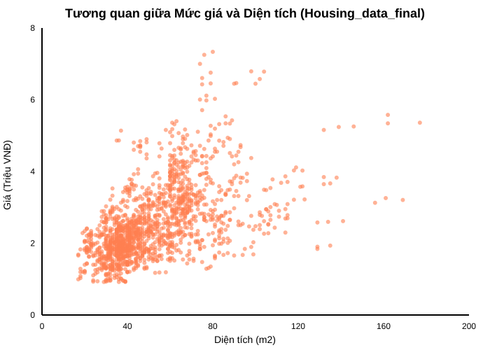
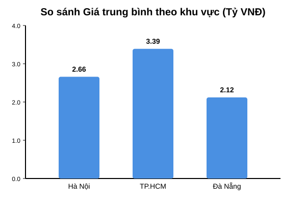

# Báo cáo tiến độ dự án môn Khoa học Dữ liệu

## Phần 1: Tổ chức & tiến độ
**1. Thông tin chung**
- **Đề tài được chọn:** Phân tích giá thuê nhà trọ/căn hộ theo khu vực.
- **Mục tiêu dự án:** Phân tích ảnh hưởng của các yếu tố (diện tích, độ dài, khoảng cách trung tâm...) đến giá cả, tiến hành so sánh giá giữa các khu vực và xây dựng mô hình dự đoán giá thuê nhà/căn hộ nhằm tối ưu việc tìm nơi ở.
- **Link lưu trữ (GitHub):** [SonNX24042005/BTL_KHDL](https://github.com/SonNX24042005/BTL_KHDL)

**2. Tình trạng phân công thu thập dữ liệu**
Hiện tại nhóm đã tiến hành phân công cho các thành viên trực tiếp crawl dữ liệu từ các website bất động sản lớn tại Việt Nam. Hạn chót (Deadline) để thu thập xong dữ liệu thô báo cáo là **17/04/2026**.
- **Hồng Dương:** https://batdongsan.com.vn/
- **Thành An:** https://alonhadat.com.vn/
- **Gia Phát:** https://www.nhatot.com/
- **Thành Đạt:** https://phongtro123.com/
- **Danh Dũng:** https://lozido.com/
- **Mạnh Quyền:** https://chothuephongtro.me/

***

## Phần 2: Đánh giá chất lượng dữ liệu cào sơ bộ
### 2.1. Tệp dữ liệu `Housing_data_final.csv` (Dữ liệu đã dọn sạch)
Đây là tập dữ liệu có chất lượng tốt nhất trong số các tệp hiện có. Tất cả các biến số đều đã được chuẩn hoá dưới dạng số học và không phát hiện bất kỳ dữ liệu nào bị khuyết thiếu.
* **Kích thước:** `1635 dòng × 10 cột`

**Các trường dữ liệu định lượng chính:**
| Mức định giá/Đo lường | Min | Max | Trung bình (Mean) |
| :--- | :--- | :--- | :--- |
| **Giá cả** (`price`) | 921,053 | 7,335,780 | 2,572,058.52 |
| **Diện tích** (`area`) | 17 | 177 | 52.90 |

### 2.2. Các tệp dữ liệu vùng miền (`hn.csv`, `hcm.csv`, `dn.csv`)
Ba tập dữ liệu được cào rời này có cùng chung một cấu trúc 5 biến đặc trưng. Hiện tại các tệp này **không** có dữ liệu rỗng (Null)
| Khu vực thống kê | Dữ liệu tổng (Rows) | Giá trị Trung bình | Diện tích Trung bình |
| :--- | :--- | :--- | :--- |
| **Đà Nẵng** | 768 | 2.12 | 26.94 m² |
| **Hà Nội** | 3,284 | 2.66 | 26.28 m² |
| **TP.HCM** | 9,733 | 3.39 | 26.35 m² |

### 2.3. Tệp dữ liệu thô `Hanoi_housing_dataset.csv`
Đây là tệp dữ liệu nguyên bản mang độ rác (noise) lớn nhất, chưa hề qua bộ lọc nào `(82,497 mẫu × 13 cột)`.